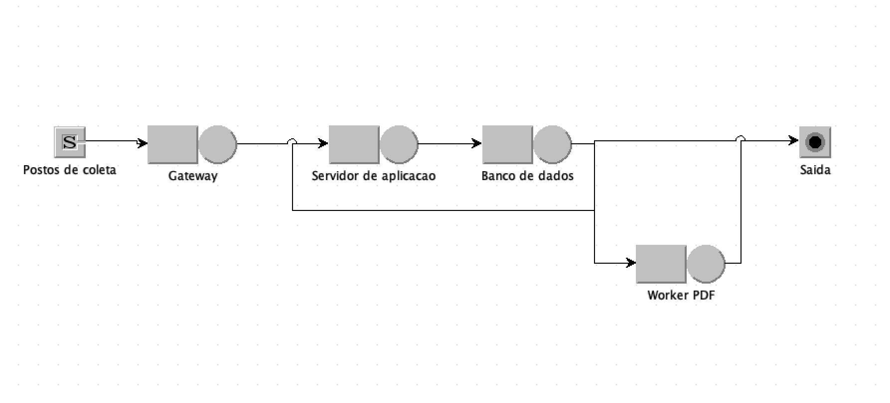
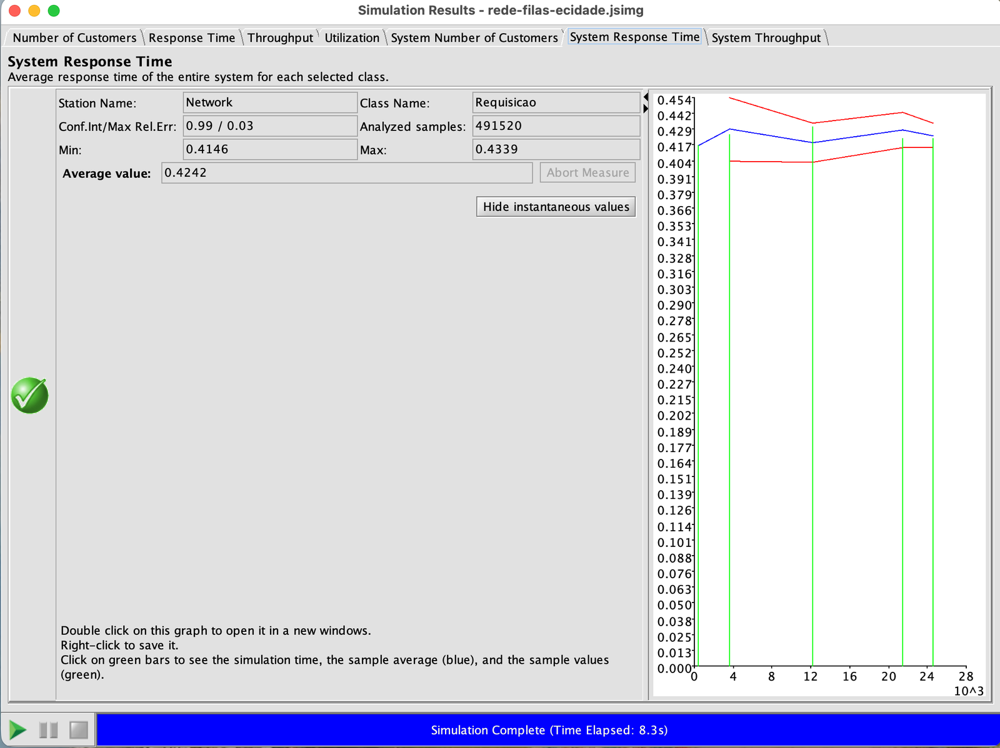
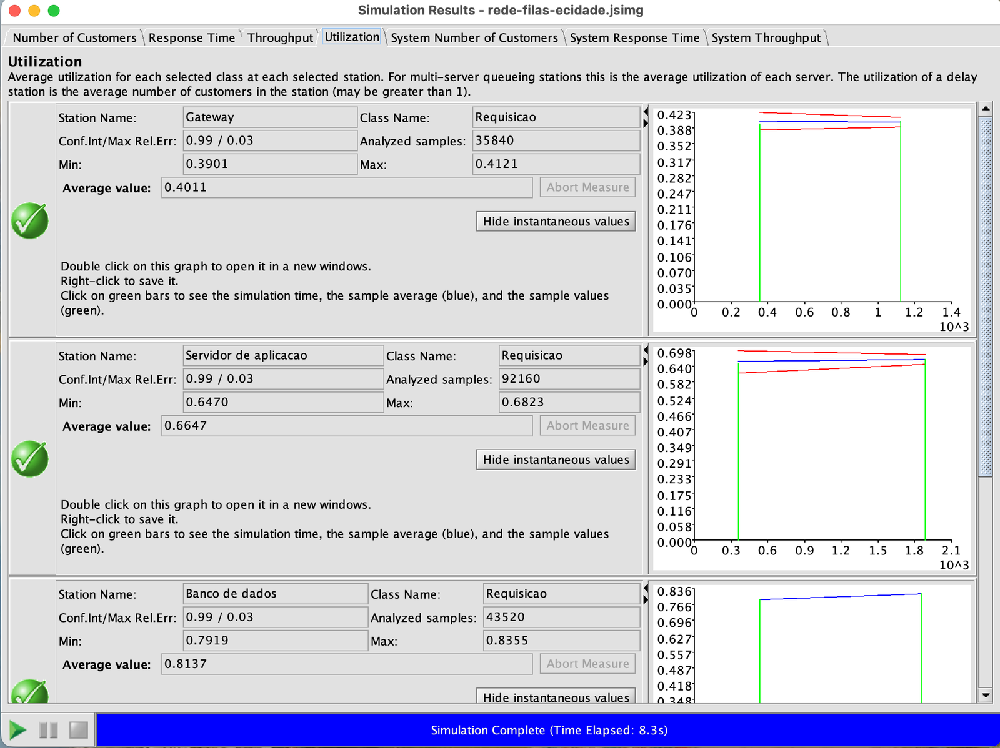
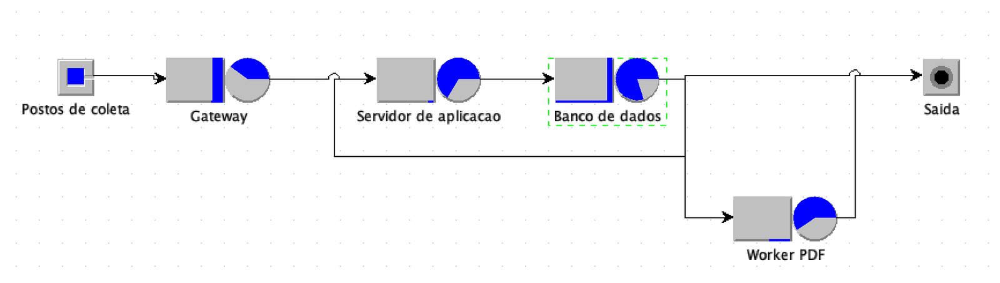
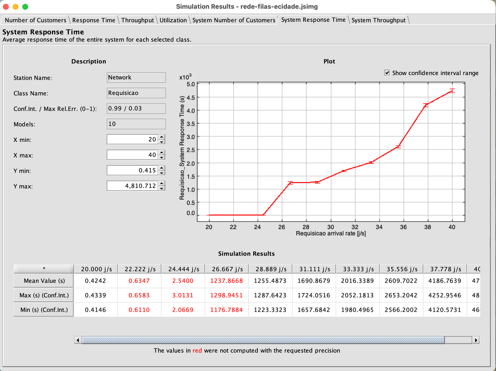
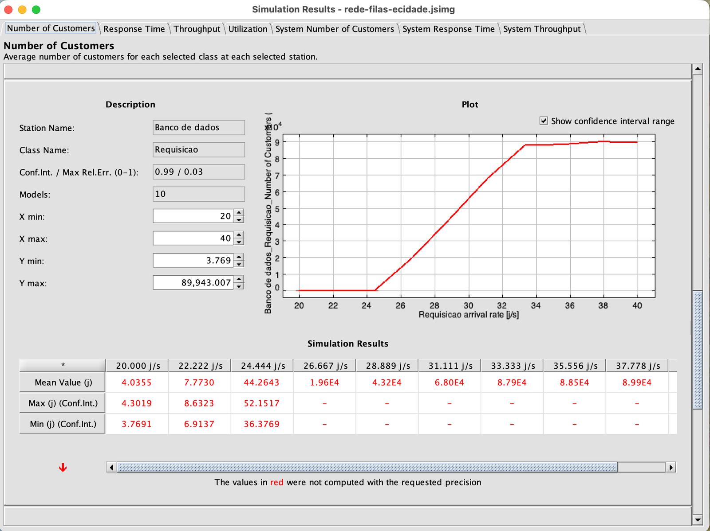

# Rede de filas: o caminho de uma requisição no e-Cidade Laboratório

Ponderada · Módulo 8 · Inteli — Débora Nogueira

**Vídeo de apresentação (até 5 min):** [link do Google Drive](COLE-AQUI-O-LINK-DO-DRIVE)

## Enunciado

Fazer a simulação de uma rede de filas no software JMT e gravar um vídeo de até 5 minutos descrevendo o modelo de rede de filas construído, como a simulação foi realizada e uma análise dos resultados.

## O problema

Esta atividade modela, como uma rede de filas aberta, o caminho que uma requisição percorre dentro do sistema de Laboratório do e-Cidade, desde o momento em que um posto de coleta envia um pedido até a resposta final. O contexto se inspira no módulo de Laboratório da Saúde, com o qual o grupo trabalha no módulo 8, e os parâmetros são hipotéticos, definidos para fins de estudo, sem uso de medições reais de produção. A pergunta que o modelo responde é a que um time de arquitetura faria antes de uma expansão: com a carga atual, quanto tempo uma requisição leva para ser atendida, qual componente limita o desempenho do sistema e até que volume de requisições a arquitetura aguenta antes de saturar.

A requisição entra por um gateway, é processada por um dos dois servidores de aplicação e consulta o banco de dados. Como uma mesma operação costuma exigir mais de uma consulta, parte das requisições volta do banco para o servidor de aplicação, formando um ciclo de retorno. Quando o resultado de um exame é liberado, a requisição segue ainda para um worker assíncrono que gera o PDF do laudo.



## O modelo

Todas as estações seguem a disciplina FCFS (primeiro a chegar, primeiro a ser atendido), com fila de capacidade infinita e tempos de serviço exponenciais. As chegadas formam um processo de Poisson. Com essas hipóteses, cada estação se comporta como uma fila M/M/1 ou M/M/c, e a rede como um todo é uma rede de Jackson aberta, o que permite calcular os resultados esperados pela teoria e compará-los com a simulação.

| Estação | Servidores | Tempo médio de serviço | Papel no sistema |
|---|---|---|---|
| Postos de coleta (fonte) | — | chegadas a λ = 20 req/s | origem das requisições |
| Gateway | 1 | 20 ms | autenticação e roteamento |
| Servidor de aplicação | 2 | 40 ms | regras de negócio |
| Banco de dados | 1 | 24 ms | consultas e gravações |
| Worker PDF | 1 | 120 ms | geração assíncrona do laudo |

O roteamento é determinístico até o banco de dados. Na saída do banco, 40% das requisições voltam ao servidor de aplicação para uma nova consulta, 15% seguem para o Worker PDF e 45% saem do sistema com a resposta pronta. Por causa do ciclo de retorno, cada requisição passa em média 1/(1 − 0,4) ≈ 1,67 vez pelo servidor de aplicação e pelo banco, e 0,15 × 1,67 = 0,25 vez pelo Worker PDF. Isso faz o banco receber, na prática, 33,3 req/s, e não 20.

## Como a simulação foi feita

O modelo foi construído no JSIMgraph, ferramenta de simulação por eventos discretos do JMT 1.5.0, e está no arquivo [`rede-filas-ecidade.jsimg`](rede-filas-ecidade.jsimg). A simulação usa a semente 23000 e para cada medida quando atinge 99% de confiança com erro relativo máximo de 3%, ou quando chega a 1 milhão de amostras. Foram coletadas, por estação, a utilização, o número médio de requisições, o tempo de resposta e o throughput, além das medidas do sistema inteiro.

A análise foi feita em duas etapas. A primeira simula o cenário base, com 20 req/s, e compara cada resultado com o valor previsto pela teoria de filas. A segunda usa a análise What-if do JMT para repetir a simulação 10 vezes, variando a taxa de chegada de 20 a 40 req/s, e observar como o sistema se comporta à medida que se aproxima da saturação.

## Resultados

### Cenário base (20 req/s)

A simulação reproduziu os valores teóricos, sempre dentro do intervalo de confiança do JMT.

| Estação | Utilização (teoria) | Utilização (JMT) | Requisições na estação (teoria) | Requisições na estação (JMT) |
|---|---|---|---|---|
| Gateway | 40,0% | 40,1% | 0,67 | 0,66 |
| Servidor de aplicação | 66,7% | 66,5% | 2,40 | 2,38 |
| **Banco de dados** | **80,0%** | **81,4%** | **4,00** | **4,04** |
| Worker PDF | 60,0% | — | 1,50 | 1,48 |

O tempo médio de resposta do sistema foi de **0,424 s**, com intervalo de confiança entre 0,415 s e 0,434 s, contra 0,428 s previstos pela teoria.





O banco de dados é o gargalo do sistema. É a estação mais ocupada, e também a que mais pesa no tempo de resposta: somando as passagens de uma requisição por cada estação, o banco responde por cerca de 0,20 s dos 0,43 s, quase metade do total, seguido pelo servidor de aplicação (0,12 s), pelo Worker PDF (0,075 s) e pelo gateway (0,033 s). O servidor de aplicação recebe o mesmo volume que o banco, mas fica menos ocupado porque divide o trabalho entre dois servidores.

Depois da simulação, o próprio JSIMgraph desenha esses resultados no modelo: o círculo de cada estação vira um gráfico de pizza da utilização e a barra da fila mostra quantas requisições esperam ali.



A medida de número de requisições no banco não atingiu a precisão pedida antes do limite de amostras, embora a média (4,04) esteja próxima da teórica (4,00). Isso acontece justamente por ele ser o gargalo: uma fila com o servidor ocupado 80% do tempo oscila muito, entre vazia e longa, e exige mais observações para que a média se estabilize.

### Análise What-if (20 a 40 req/s)

A teoria prevê que o banco satura quando a taxa de chegada atinge 1 / (1,67 × 0,024 s) = 25 req/s. A análise What-if confirma esse limite e mostra que o tempo de resposta cresce de forma não linear à medida que o sistema se aproxima dele.

| Chegadas (req/s) | Utilização do banco | Tempo de resposta (JMT) | Tempo de resposta (teoria) |
|---|---|---|---|
| 20,0 | 80% | 0,42 s | 0,43 s |
| 22,2 | 89% | 0,63 s | 0,63 s |
| 24,4 | 98% | 2,54 s | 2,15 s |
| 26,7 ou mais | acima de 100% | instável | infinito |



Entre 20 e 22,2 req/s, um aumento de 11% na carga eleva o tempo de resposta em 50%. Entre 22,2 e 24,4 req/s, um aumento semelhante o multiplica por quatro. A partir de 26,7 req/s, chegam ao banco mais requisições do que ele consegue processar, a fila cresce sem limite e os valores exibidos pelo JMT (acima de mil segundos) refletem apenas o tamanho que a fila atingiu até a simulação parar, e não uma média de regime.



O What-if também mostra o efeito em cascata da saturação. Com o banco travado na sua capacidade máxima de 41,7 consultas por segundo, o Worker PDF recebe um fluxo limitado e estabiliza em cerca de 3 requisições, enquanto o servidor de aplicação passa a acumular, além das chegadas externas, os retornos do banco, até também saturar por volta de 33 req/s. O gateway, por sua vez, segue estável em toda a faixa.

## Conclusão

Com os parâmetros adotados, a arquitetura atende 20 req/s com tempo médio de resposta de 0,42 s, mas opera perto do seu limite: o banco de dados define o teto do sistema em 25 req/s, e acima de 22 req/s o tempo de resposta passa a crescer rapidamente. Para absorver mais carga, a intervenção precisa estar no banco, seja reduzindo o tempo de cada consulta, seja diminuindo o número de idas ao banco por requisição (o ciclo de retorno de 40%), por exemplo com cache ou réplicas de leitura. Ampliar o gateway ou o servidor de aplicação não altera esse limite.

## Limitações

O modelo assume chegadas de Poisson e tempos de serviço exponenciais, uma única classe de requisição e probabilidades de roteamento fixas, o que simplifica a variedade de operações reais do sistema (consultas leves e relatórios pesados, por exemplo). Também não representa limites de conexões no banco, timeouts nem reenvio de requisições, que em um sistema real mudariam o comportamento acima da saturação. Com logs de produção, os tempos de serviço e as probabilidades poderiam ser estimados a partir de medições, e a ferramenta JWAT do próprio JMT poderia caracterizar a carga.

## Como executar

1. Instale o Java 21 ou mais recente (por exemplo, o Eclipse Temurin) e baixe o `JMT-singlejar-1.5.0.jar` em [jmt.sourceforge.net](https://jmt.sourceforge.net).
2. Abra o JMT com `java -jar JMT-singlejar-1.5.0.jar` e escolha **JSIMgraph**.
3. Em **File → Open**, abra `rede-filas-ecidade.jsimg` e clique no **▶**. O arquivo já vem com o What-if ativado (Arrival rates, de 20 a 40 req/s, 10 passos).
4. Para rodar só o cenário base, clique em **WHAT if**, desmarque **Enable What-If analysis** e clique no **▶** de novo.

## Estrutura

```
rede-filas-ecidade.jsimg          modelo da rede de filas para o JSIMgraph (JMT 1.5.0)
rede-filas-ecidade.legacy.jsimg   cópia gerada pelo JMT para versões até a 1.4.0
roteiro-video.md                  roteiro do vídeo de até 5 minutos
assets/                           capturas do modelo e dos resultados no JMT
```
